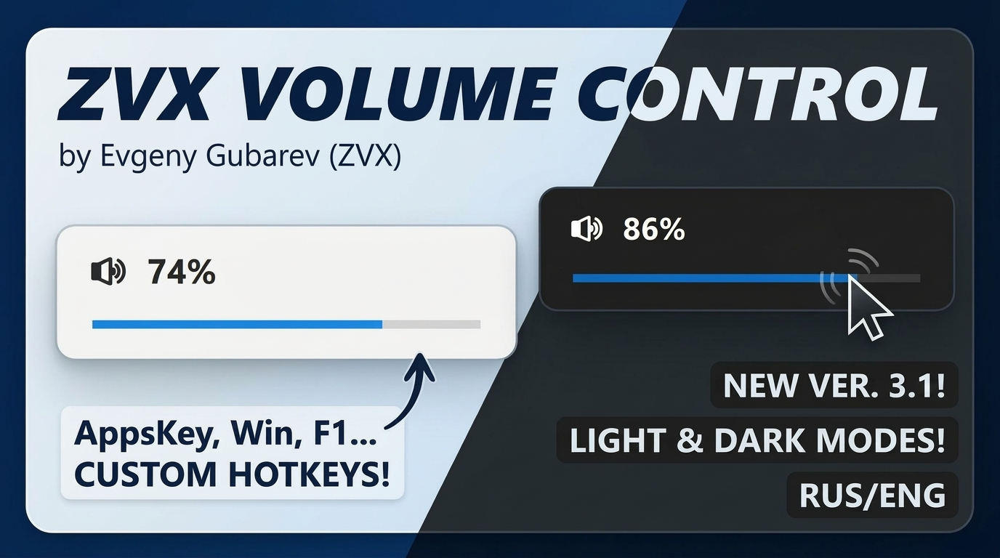

# ZVX-VolumeControl v3.1

Select your language / Выберите язык:

  

---
A lightweight Windows utility to adjust system volume by holding a hotkey and moving your mouse.  
---
Утилита для Windows для быстрой регулировки громкости зажатием клавиши и движением мыши.
---

